  

<h1 align="center">Schema Drift Observatory</h1>

  <strong>Detect selected API contract changes before they reach consumers.</strong> 
  A Go CLI that compares a baseline OpenAPI specification with a candidate and reports a documented subset of compatibility changes.

  
  
  
  
  

> [!IMPORTANT]
> **Early MVP / active development.** The CLI implements six selected comparison rules, not full OpenAPI compatibility analysis. The dashboard shows a bundled example report and is not connected to the CLI. Review the [known limitations](#known-limitations) before relying on findings in a release workflow.

  <a href="#what-is-implemented-today">Implemented scope</a> ·
  <a href="#architecture">Architecture</a> ·
  <a href="#quick-start">Quick start</a> ·
  <a href="#ci-and-current-verification">CI & tests</a> ·
  <a href="#known-limitations">Limitations</a> ·
  <a href="#roadmap">Roadmap</a>

---

## Why it exists

API specifications can change in ways that affect existing clients. Removing an operation, adding a required request parameter, or changing a request body can break consumers even when the specification remains valid.

Schema Drift Observatory aims to make selected changes easier to review by producing findings with a rule ID, category, affected operation, location, explanation, impact, and remediation guidance. It can also return a process exit code for simple CI policy checks.

## What is implemented today

### Go comparison CLI

- Parses input through `pb33f/libopenapi` and builds an internal normalized model.
- Accepts baseline and candidate specification file paths.
- Produces a terminal summary or JSON output.
- Reports selected operation, parameter, and request/response property changes.
- Sorts generated findings to make report ordering deterministic for the implemented rules.
- Supports a configurable `--fail-on` category list.
- Provides `--version` output.

### Implemented rule subset

| Rule | Current behavior | Current category |
|---|---|---|
| `SDO-001` | Detects an operation present in the baseline but absent from the candidate | `breaking` |
| `SDO-002` | Detects a newly added required operation-level parameter | `breaking` |
| `SDO-003` | Detects a removed operation-level parameter or an optional parameter changed to required | `potentially_breaking` for removal; `breaking` for newly required |
| `SDO-004` | Detects a new required request-body property or an existing request property changed from optional to required | `breaking` |
| `SDO-005` | Detects a removed top-level property from the `200` `application/json` response schema | `breaking` |
| `SDO-006` | Detects a new property in the `200` `application/json` response schema | `non_breaking` under a tolerant-reader assumption |

These rules cover a limited subset, not every possible contract change. In particular, the current implementation does **not** compare schema property types or enum values. See [Known limitations](#known-limitations) before relying on the result.

### Dashboard prototype

The `dashboard/` directory contains a Vue 3 + TypeScript + Vite single-page application. It currently imports `dashboard/src/assets/sample-report.json` at build time and displays that example report. It is **not yet connected to the Go CLI**, does not upload specifications, and does not dynamically run comparisons.

The bundled example JSON is illustrative only. Its current summary counts do not match the findings array, so do not use it as evidence of engine accuracy until the fixture is corrected.

## Architecture

~~~mermaid
flowchart LR
    A[Baseline OpenAPI file] --> C[Go CLI]
    B[Candidate OpenAPI file] --> C
    C --> D[libopenapi parser]
    D --> E[Normalized model]
    E --> F[SDO-001 to SDO-006 rules]
    F --> G[Text summary or JSON report]
    G --> H[Configurable exit policy]
    I[Bundled sample-report.json] --> J[Vue dashboard prototype]
~~~

The CLI is the primary implementation. The dashboard is currently a separate demo surface and should not be assumed to represent a live comparison.

## Technology

| Area | Technology |
|---|---|
| Core language | Go |
| OpenAPI parsing | `github.com/pb33f/libopenapi` |
| CLI arguments | Go standard library `flag` |
| Dashboard | Vue 3, TypeScript, Vite |
| CI | GitHub Actions |
| Test framework | Go `testing` package |

The module currently declares Go `1.27.0` in `go.mod`. Use a matching Go toolchain; Go's automatic toolchain selection may download it if enabled.

## Quick start

### Prerequisites

- Go toolchain compatible with `go.mod` (`go 1.27.0` at the time of this update).
- Two OpenAPI files that are valid inputs for the current parser.
- Node.js and npm only if you want to run the dashboard prototype.

### Build and test the CLI

From the repository root:

~~~powershell
go mod download
go test ./...
go vet ./...
go build -o schema-drift-observatory.exe .
~~~

Check the CLI version:

~~~powershell
.\schema-drift-observatory.exe --version
~~~

### Compare two specifications

Replace the example paths below with the actual locations of your baseline and candidate specifications:

~~~powershell
.\schema-drift-observatory.exe --baseline ./path/to/baseline.yaml --candidate ./path/to/candidate.yaml --format text --fail-on breaking
~~~

Request JSON output for automation:

~~~powershell
.\schema-drift-observatory.exe --baseline ./path/to/baseline.yaml --candidate ./path/to/candidate.yaml --format json --fail-on breaking,potentially_breaking
~~~

Supported flags:

| Flag | Purpose |
|---|---|
| `--version` | Print the CLI version and exit |
| `--baseline` | Path to the baseline OpenAPI file |
| `--candidate` | Path to the candidate OpenAPI file |
| `--format text` or `--format json` | Select the terminal summary or JSON report |
| `--fail-on` | Comma-separated finding categories that cause a policy-failure exit |

### Exit codes

| Exit code | Meaning |
|---:|---|
| `0` | Comparison completed and no selected `--fail-on` category was found |
| `1` | Comparison completed and at least one selected category was found |
| `2` | Required arguments are missing, an input cannot be read, or parsing/extraction failed |

The default policy is `--fail-on breaking`. To fail on both breaking and potentially breaking findings, pass `--fail-on breaking,potentially_breaking`.

**Important:** The JSON field `compatible` is currently set to `false` only when at least one `breaking` finding exists. A report can therefore have `compatible: true` and still contain `potentially_breaking` findings. Configure `--fail-on` explicitly for your intended CI policy.

### Run the dashboard prototype

~~~powershell
cd dashboard
npm ci
npm run dev
~~~

This launches the current static report viewer using the bundled sample JSON. It does not launch the Go CLI or compare user-supplied files.

## CI and current verification

The GitHub Actions workflow at `.github/workflows/ci.yml` currently checks:

- Go formatting (`gofmt -s -l`)
- `go vet ./...`
- `go test -v ./...`
- `go build -v ./...`

The latest observed workflow run before this README update completed successfully: [CI run #5](https://github.com/tracolerd/schema-drift-observatory/actions/runs/38937094715). It ran **three explicit Go unit tests**: operation removal, required parameter addition, and optional response property addition. This is a useful baseline, but it is not broad evidence of compatibility coverage.

The current CI workflow does not build or test the Vue dashboard. The dashboard has a build script in `dashboard/package.json`, but its build has not been verified by this audit.

## Known limitations and audit notes

The following are current implementation gaps, not supported features:

1. **Incomplete response coverage.** Response comparison only examines a `200` response with `application/json`. Removing the `200` response, switching the response content type, or using another success status can bypass the current response-property rules.
2. **Schema type and enum changes are not compared.** The normalized model has fields for some schema metadata, but extraction/rules do not currently detect changes to existing property types or enum values.
3. **Path-level parameters are not extracted.** Parameter comparison currently considers parameters attached to individual operations.
4. **HTTP method coverage is partial.** The extractor currently handles `GET`, `POST`, `PUT`, `DELETE`, and `PATCH`; `HEAD` and `OPTIONS` are not included.
5. **Unsupported constructs are not consistently reported as `undetermined`.** The design notes describe an intended `undetermined` category, but the current rules do not comprehensively emit it for unsupported schema constructs. No finding must not be interpreted as proof of compatibility.
6. **CLI option validation needs hardening.** Unsupported `--format` values currently fall back to text output. Unknown `--fail-on` category names are not rejected; a typo can therefore weaken a CI policy.
7. **No input-size limit is enforced by the CLI.** Input files are read into memory; add explicit size/resource limits before processing untrusted or very large specifications.
8. **The dashboard is static.** There is no browser-to-CLI integration, upload workflow, API server, or live comparison state.
9. **The sample dashboard counts are inconsistent.** The bundled JSON says there are two breaking findings but lists only one breaking finding; correct the fixture and add a consistency test.
10. **Coverage is narrow.** The current Go tests do not yet cover the full rule set, parser/extractor edge cases, CLI exit policies, malformed input, deterministic report behavior, or the listed limitation cases.
11. **CI toolchain configuration should be aligned.** The workflow requests Go `1.22`, while `go.mod` declares `1.27.0`; current CI succeeds through Go's automatic toolchain selection, but the versions should be made explicit and consistent.
12. **Windows build script should fail fast.** `build.ps1` formats, vets, and builds, but does not run tests and does not explicitly stop on a failing vet step before proceeding.

For a compatibility checker, false negatives are more dangerous than an honest “unsupported / undetermined” result. Treat this build as a learning MVP until the gaps above are closed with rules, tests, and documented semantics.

## Roadmap

### P0 — Trustworthy compatibility results

- Validate `--format` and `--fail-on` inputs; reject unknown values.
- Add bounded input reading and clear validation errors.
- Detect missing/changed response status codes and media types.
- Compare existing schema property types, enum values, and relevant requiredness changes.
- Extract and merge path-level and operation-level parameters according to OpenAPI rules.
- Emit `undetermined` findings when a change cannot be evaluated safely.
- Expand parser, rule, CLI, and regression tests.

### P1 — Make the demo honest and useful

- Correct the bundled sample-report summary counts.
- Add a fixture-consistency test.
- Verify the dashboard production build and add it to CI.
- Clearly label sample data in the UI.

### P2 — Improve developer workflow

- Align the Go version in CI with `go.mod`.
- Make `build.ps1` stop on errors and run tests.
- Add representative baseline/candidate OpenAPI fixtures and copy-pasteable end-to-end examples.
- Add release artifacts and a more complete CI integration example after the CLI contract stabilizes.

### Future directions

GraphQL, gRPC/Protocol Buffers, historical report storage, and a live dashboard integration are deferred. They should be considered only after the OpenAPI comparison semantics and test coverage are dependable.

## Repository layout

~~~text
.
├── main.go
├── internal/
│   ├── engine/        # Compatibility rules and evaluator
│   ├── model/         # Normalized comparison model
│   └── parser/        # OpenAPI parsing and extraction
├── dashboard/         # Vue 3 static report-viewer prototype
├── docs/              # Decisions, project state, scope/contract notes
├── examples/          # Illustrative CI workflow
├── .github/workflows/ # Go CI pipeline
├── go.mod
└── build.ps1
~~~

## Contributing

Issues and focused pull requests are welcome. For behavior changes, include a minimal baseline/candidate fixture pair, explain the compatibility assumption, and add tests that cover both the expected finding and a nearby non-breaking or unsupported case.
---

## Creator, Developer & Maintainer

**Created, designed, developed, and maintained by [Nurul Faiyaz](https://github.com/tracolerd).**

This project is independently built and maintained by Nurul Faiyaz. The project's design, implementation, and documentation are his work.

  
  
  
  
  
  
  

  <a href="https://www.facebook.com/faiyaz.888">Facebook</a> ·
  <a href="https://www.instagram.com/tracolerd">Instagram</a> ·
  <a href="https://www.linkedin.com/in/faiyaz-xyz">LinkedIn</a> ·
  <a href="https://x.com/faiyaz_explores">X / Twitter</a> ·
  <a href="https://github.com/tracolerd">GitHub</a> ·
  <a href="mailto:scrollfaiyaz@gmail.com">Email</a> ·
  <a href="https://nurul-faiyaz.netlify.app/">Website</a>

## License

MIT. See [LICENSE](LICENSE).